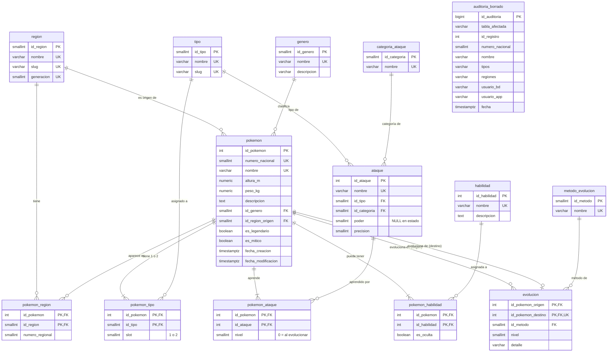

# Modelo de datos

Base para las secciones 5.1 a 5.5 del documento. El diagrama se ve en GitHub. Para el documento Word, el modelo físico se puede exportar desde pgAdmin: clic derecho en la base `pokedex` → **ERD For Database** → botón de descarga de imagen.

## Diagrama entidad-relación (físico)

`auditoria_borrado` no tiene FK a propósito: guarda copias de Pokémon que ya no existen.

## Relaciones y cardinalidad (5.1)

| Relación | Entidades | Cardinalidad | Justificación |
|---|---|---|---|
| Aparece en | Pokémon – Región | N:M (`pokemon_region`) | Un Pokémon está en la Pokédex de varias regiones (Pikachu en 8) y cada región tiene muchos Pokémon. Guarda el número regional, que depende del par. |
| Es de tipo | Pokémon – Tipo | N:M (`pokemon_tipo`), 1 a 2 por Pokémon | Un Pokémon tiene uno o dos tipos; un tipo lo comparten muchos Pokémon. `slot` distingue principal y secundario. |
| Aprende | Pokémon – Ataque | N:M (`pokemon_ataque`) | Un Pokémon aprende muchos ataques y un ataque lo aprenden muchos Pokémon. El nivel depende del par. |
| Puede tener | Pokémon – Habilidad | N:M (`pokemon_habilidad`) | Hasta tres habilidades por Pokémon; `es_oculta` depende del par. |
| Evoluciona en | Pokémon – Pokémon | 1:N recursiva (`evolucion`) | Un Pokémon puede evolucionar en varios (Wurmple en Silcoon o Cascoon) y cada uno tiene como máximo una preevolución. |
| Tiene género | Género – Pokémon | 1:N | Cada Pokémon tiene un único género posible del catálogo. |
| Es originario de | Región – Pokémon | 1:N | Cada especie se introdujo en una generación, que corresponde a una región. |
| Es de tipo / categoría | Tipo – Ataque, Categoría – Ataque | 1:N | Cada ataque tiene un tipo y una categoría. |
| Método | Método – Evolución | 1:N | Cada evolución ocurre por un método del catálogo. |

## Por qué la evolución es una tabla propia

| Alternativa | Problema |
|---|---|
| Columna `id_preevolucion` en `pokemon` | Método, nivel y detalle describen la evolución, no al Pokémon. Quedarían en `pokemon`, nulos para casi todas las filas, y mezclarían dos hechos distintos en una tabla (difícil de justificar en 3FN). |
| Tabla "cadena" con posición 1, 2, 3 | No representa ramificaciones (Wurmple → Silcoon o Cascoon; Kubfu → dos formas de Urshifu). |
| **Tabla `evolucion(origen, destino, …)`** ✔ | Cada fila es una evolución con sus propios atributos. Soporta ramificaciones, `UNIQUE(destino)` garantiza una sola preevolución y la cadena completa se recorre con `WITH RECURSIVE`. |

## Integridad referencial

| FK | ON DELETE | Por qué |
|---|---|---|
| tablas puente → `pokemon` | CASCADE | Si se borra un Pokémon, sus tipos, regiones, ataques y habilidades no tienen sentido solos. La auditoría se toma antes, en un trigger BEFORE DELETE. |
| `evolucion` → `pokemon` (origen y destino) | CASCADE | Una evolución sin uno de sus dos Pokémon no existe. |
| `pokemon_region` → `region` | RESTRICT | No se puede borrar una región con Pokémon asociados (demostración 8.3). |
| `pokemon` → `region` (origen), `genero` | RESTRICT | Son catálogos en uso. |
| `pokemon_tipo` / `ataque` → `tipo`; `ataque` → `categoria_ataque`; `pokemon_ataque` → `ataque`; `pokemon_habilidad` → `habilidad`; `evolucion` → `metodo_evolucion` | RESTRICT | Un dato de catálogo no se borra mientras se use. |
| Todas | ON UPDATE NO ACTION | Las PK son IDENTITY `GENERATED ALWAYS`: PostgreSQL no permite modificarlas, así que no hay cambios que propagar. |

## Reglas que garantiza la base

| Regla | Cómo |
|---|---|
| Uno o dos tipos, nunca repetidos | PK `(id_pokemon, id_tipo)` + `UNIQUE(id_pokemon, slot)` + `CHECK (slot IN (1,2))` |
| Nunca sin tipo | Constraint trigger diferido `trg_pokemon_requiere_tipo`: al COMMIT exige el slot 1; si falta, revierte la transacción |
| Una sola habilidad oculta | Índice único parcial `ux_pokemon_habilidad_oculta … WHERE es_oculta` |
| No es legendario y mítico a la vez | `CHECK (NOT (es_legendario AND es_mitico))` |
| Un Pokémon no evoluciona en sí mismo | `CHECK (id_pokemon_origen <> id_pokemon_destino)` |
| Poder y precisión válidos | `CHECK` 1–250 y 1–100; NULL en estado, poder variable o "nunca falla" |
| Número regional único por región | `UNIQUE(id_region, numero_regional)` |

## Índices

| Índice | Consulta que acelera |
|---|---|
| `ix_pokemon_nombre_lower` (`lower(nombre) varchar_pattern_ops`) | Búsqueda por nombre en el listado: `lower(nombre) LIKE 'pik%'` |
| `ix_pokemon_region_region (id_region, id_pokemon)` | Filtro multirregión con `IN (:regiones)`. La PK empieza por `id_pokemon` y no sirve para buscar por región |
| `ix_pokemon_tipo_tipo`, `ix_pokemon_ataque_ataque` | Filtros por tipo y por ataque |
| `ix_pokemon_genero` | Filtro por género |
| `ix_pokemon_habilidad_habilidad` | Pokémon con una habilidad |
| `ix_ataque_tipo` | Ranking de ataques por tipo (función de ventana) y JOIN ataque–tipo |
| `ix_auditoria_fecha` | Consultar los borrados más recientes |
| PK y UNIQUE (automáticos) | Búsqueda por id, número nacional, nombre y joins de las tablas puente |

## Normalización (5.5)

| Tabla | 1FN | 2FN | 3FN |
|---|---|---|---|
| region, tipo, genero, categoria_ataque, metodo_evolucion, habilidad | Valores atómicos, sin listas | PK simple: no hay dependencias parciales | Los atributos dependen solo de la PK |
| ataque | Atómicos | PK simple | El nombre del tipo y de la categoría no se repiten aquí: se guardan las FK, evitando la dependencia transitiva `id_ataque → id_tipo → nombre_tipo` |
| pokemon | Atómicos: tipos, regiones, ataques y habilidades **no** son columnas multivaluadas, van en tablas puente | PK simple | Género y región de origen como FK a catálogos (no texto repetido). Altura, peso y descripción dependen solo del Pokémon |
| pokemon_region | Atómicos | `numero_regional` depende del par completo (Pokémon, región) | Sin atributos que dependan de otro no clave |
| pokemon_tipo | Atómicos | `slot` depende del par completo | — |
| pokemon_ataque | Atómicos | `nivel` depende del par completo: el mismo ataque se aprende a distinto nivel según el Pokémon | Poder, precisión, tipo y categoría están en `ataque`, no aquí |
| pokemon_habilidad | Atómicos | `es_oculta` depende del par completo | — |
| evolucion | Atómicos | Método, nivel y detalle dependen del par (origen, destino) | El nombre del método está en el catálogo |
| auditoria_borrado | Atómicos (`tipos` y `regiones` son una cadena histórica de solo lectura, no se consultan por partes) | PK simple | **Desnormalización intencional:** copia los datos del Pokémon borrado porque las filas originales ya no existen; es un registro histórico, no datos vivos |
